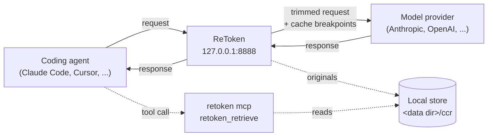

<div align="center">


# ReToken

**Cut the token bill of Claude Code and other coding agents, without hiding anything from the model.**

A local Rust proxy that sits between your coding agent and the model provider. It trims noisy tool output, keeps prompt caches warm and lets the model recover anything it shortened.

[](https://github.com/AshleyImmanuel/ReToken/actions/workflows/ci.yml)
[](https://github.com/AshleyImmanuel/ReToken/releases)
[](LICENSE)


[Quick start](#quick-start) · [Results](#results) · [How it works](#how-it-works) · [Configuration](#configuration) · [Architecture](#architecture)

</div>

---

## Why ReToken

Coding agents re-send the whole conversation on every turn: build logs, test output, JSON responses and file reads. That repeated input is most of an agent's API bill. ReToken removes the noise from it on the wire, so the same agent finishes the same task for less, with no change to the agent.

- **Built for coding agents.** Used day to day with Claude Code. It forwards both API keys and Claude Code subscription (OAuth) logins unchanged. Any client that lets you set an Anthropic or OpenAI base URL can point at it.
- **Speaks both wire formats.** Anthropic Messages, OpenAI Chat Completions and OpenAI Responses.
- **Stays on your machine.** Listens on `127.0.0.1` only and forwards each request to the provider your agent already uses, with the agent's own credentials.
- **Every lossy change can be undone.** The model can fetch the original of anything ReToken shortened through the `retoken_retrieve` MCP tool.

## Results

Headless Claude Code benchmark (Claude Sonnet, Claude Code 2.1, November 2026). Each setup ran three tasks (explain code, fix a failing test, summarize a module) three times from a clean checkout. All 36 runs produced a correct answer.

| Setup | Cost per task | Turns | Seconds | Output tokens |
| :--- | ---: | ---: | ---: | ---: |
| Direct to the API | $0.0425 | 4.78 | 12.7 | 859 |
| caveman proxy | $0.0330 | 4.33 | 13.4 | 870 |
| ReToken | $0.0329 | 4.33 | 12.8 | 826 |
| **ReToken + terse mode** | **$0.0302 (−29%)** | **3.78** | **11.4** | **719** |

This is a small sample of short tasks, so treat the numbers as indicative. A benchmark on long, log-heavy sessions has not been run yet. The harness is in [`benchmarks/`](benchmarks/README.md) so you can re-run it yourself.

## Quick start

**1. Install**

Download the archive for your platform from the [latest release](https://github.com/AshleyImmanuel/ReToken/releases/latest) (Linux x86_64, macOS Intel and Apple Silicon, Windows x86_64; checksums in `checksums.txt`) and put `retoken` on your `PATH`.

Or build from source with a recent stable Rust toolchain:

```bash
git clone https://github.com/AshleyImmanuel/ReToken.git
cd ReToken
cargo install --path cli        # installs `retoken` into ~/.cargo/bin
```

**2. Connect your agent**

<details open>
<summary><b>Claude Code</b></summary>

```bash
claude mcp add retoken -- retoken mcp   # lets the model recover shortened output
retoken wrap claude                     # starts the proxy and runs Claude Code through it
```

</details>

<details>
<summary><b>opencode</b></summary>

Point the provider's base URL at `http://127.0.0.1:8888/v1`, then register the retrieval server in `opencode.jsonc`:

```jsonc
"mcp": { "retoken": { "type": "local", "command": ["retoken", "mcp"] } }
```

</details>

<details>
<summary><b>Cursor, Windsurf and other IDEs</b></summary>

Start the proxy with `retoken run`, then set the IDE's custom provider or OpenAI base URL to `http://127.0.0.1:8888/v1`. Keep your API key as it is; ReToken forwards it unchanged.

IDE setups are not covered by the test suite. Some IDEs send custom-base-URL requests from their own servers instead of your machine, and those requests cannot reach a proxy on `127.0.0.1`.

</details>

<details>
<summary><b>Aider and other CLI agents</b></summary>

```bash
retoken wrap aider
```

`wrap` starts the proxy if it is not running and sets the base-URL environment variables for the wrapped command only.

</details>

**3. Check it works**

```bash
retoken doctor   # proxy status, config, storage and provider connectivity
retoken stats    # tokens saved, cache hit ratio, bytes transferred
```

Prefer to let an agent set it up? Ask it: *"Read AI_INSTALL.md in https://github.com/AshleyImmanuel/ReToken and integrate ReToken after showing me what will change."* [`AI_INSTALL.md`](AI_INSTALL.md) also covers verification and rollback.

## How it works



1. **The model always sees what it is reading.** A file read reaches the model in full on the turn it is read. Only after the model has moved on does a large file shrink to an outline (signatures, types, exact line numbers) with a handle to the original.
2. **Noise goes, failures stay.** Large build, test and log output is shortened, but errors, assertion details and test summaries are always kept. Large uniform JSON arrays keep their first and last items, any error items and statistical outliers. Exact repeats of earlier tool output become a reference to the first copy.
3. **Lossy only when reversible.** Lossy changes are applied only when the agent exposes the `retoken_retrieve` tool. Without it, ReToken makes lossless changes only. User prompts, system instructions, assistant history, tool definitions and code comments are never altered.
4. **Prompt caches stay warm.** Each tool result changes at most once, so history stays byte-stable. ReToken places Anthropic cache breakpoints (following the client's TTL, including a rolling breakpoint on the conversation tail) and orders OpenAI tools deterministically, so repeated history is billed at the cached rate.
5. **Optional terse mode.** Asks the model for short prose replies while keeping code, commands and tool inputs unchanged.

## Configuration

ReToken reads `retoken.json`, `.retoken.json` or `.retoken/config.json` from the working directory, then applies `RETOKEN_*` environment variables on top. Partial files are fine; anything omitted keeps its default. A malformed file stops startup with an error.

```json
{ "port": 8888, "terse_mode": true }
```

| Setting | Env variable | Default | What it does |
| :--- | :--- | :--- | :--- |
| `compression_enabled` | `RETOKEN_COMPRESSION_ENABLED` | `true` | Tool-output compression (lossless unless the retrieval tool is present) |
| `prompt_caching_enabled` | `RETOKEN_PROMPT_CACHING_ENABLED` | `true` | Anthropic cache breakpoints and OpenAI prefix canonicalization |
| `terse_mode` | `RETOKEN_TERSE_MODE` | `false` | Ask the model for terse prose replies |
| `ccr_enabled` | `RETOKEN_CCR_ENABLED` | `false` | Proxy-side replay of `retoken_retrieve` calls (experimental) |
| `cache_enabled` | `RETOKEN_CACHE_ENABLED` | `true` | Exact-match response cache for deterministic requests |
| `cache_ttl_secs` | `RETOKEN_CACHE_TTL_SECS` | `300` | Response cache entry lifetime |
| `port` | `RETOKEN_PORT` | `8888` | Loopback port to listen on |
| `upstream_timeout_secs` | `RETOKEN_UPSTREAM_TIMEOUT_SECS` | `60` | Connect and idle-read timeout to the provider |
| `allowed_upstream_hosts` | `RETOKEN_ALLOWED_UPSTREAM_HOSTS` | any public host | Allowlist for custom upstreams |

Set `compression_enabled` and `prompt_caching_enabled` to `false` for a byte-for-byte pass-through. The full list, including memory limits, is in [`AI_INSTALL.md`](AI_INSTALL.md#step-4-choose-settings-optional).

## CLI

| Command | Purpose |
| :--- | :--- |
| `retoken run` | Start the proxy on `127.0.0.1:8888` (the default when no command is given) |
| `retoken wrap <cmd>` | Run an agent through the proxy, starting it if needed |
| `retoken mcp` | Serve the `retoken_retrieve` tool over MCP (stdio) |
| `retoken doctor` | Diagnose proxy status, latency, config, storage and connectivity |
| `retoken stats` | Show live token savings, cache hit ratio and data transferred |
| `retoken cache [status\|clear\|invalidate <key>]` | Inspect or clear the response cache |
| `retoken analyze [path]` | Symbol scan and dependency graph for Rust, Python and TypeScript/JavaScript |
| `retoken init` | Add a Claude Code project skill (`.claude/skills/retoken/SKILL.md`) that explains ReToken's retrieval markers |

## Security and privacy

- **Loopback only.** The proxy binds to `127.0.0.1` and rejects requests whose `Host` header is not a loopback name, which blocks DNS-rebinding attacks from web pages.
- **SSRF protection for custom upstreams.** Loopback, private, link-local, carrier-grade NAT, reserved and cloud-metadata ranges are blocked unless you opt in, and the verified address is pinned at connect time to close the DNS-rebinding window.
- **Credential-aware caching.** Cache keys include a SHA-256 fingerprint of the credentials and client headers, so one key's responses are never served to another. Requests that sample (temperature omitted or above zero without a seed, or `n > 1`) are not cached unless you send `x-retoken-cache-stochastic: true`.
- **Bounded memory.** Request and buffered response bodies are capped at 10 MB, and the response cache at 1,024 entries and 256 MB by default.
- **Local retention.** Originals of shortened output are stored under `<data dir>/ccr` and deleted after 7 days unused.

To report a vulnerability, see [`SECURITY.md`](SECURITY.md).

## Architecture

ReToken is a Cargo workspace. The request path runs through `gateway`, `compressors` and `core`.

| Crate | Status | Role |
| :--- | :--- | :--- |
| [`gateway`](gateway) | Implemented | `axum` proxy: provider routing, request rewriting, streaming, caching, admin routes |
| [`compressors`](compressors) | Implemented | Tool-output classification and compression, log slicing, JSON collapsing, the CCR store |
| [`core`](core) | Implemented | Configuration, response cache, session state, telemetry |
| [`cli`](cli) | Implemented | The `retoken` binary and its MCP server |
| [`mcp`](mcp) | Implemented | Standalone `retoken-mcp` server exposing proxy status, doctor and cache tools to agents |
| [`analyzers`](analyzers) | Implemented | Comment-aware symbol extraction and dependency graphs |
| [`retrieval`](retrieval) | Experimental | Context budgeting and prefix canonicalization helpers |
| [`scheduler`](scheduler) | Experimental | Tool-call DAG scheduling and prefetch prototypes (not on the request path) |

See [`ARCHITECTURE.md`](ARCHITECTURE.md) for the request data flow.

## Project status

ReToken is in active development and its author uses it daily with Claude Code. The default configuration is conservative: lossless rewriting plus cache breakpoints. Lossy elision, terse mode and proxy-side CCR replay change what the model sees, so they are opt-in or gated on the retrieval tool. CCR replay in particular has not been tested against high-volume production traffic.

Planned: `retoken trace` for per-request payload inspection, and `retoken benchmark` for one-command cost measurement.

## Contributing

Bug reports, benchmark results and new compression strategies are welcome. Read [`CONTRIBUTING.md`](CONTRIBUTING.md) to set up and open a pull request; issues labelled `good first issue` are a good place to start.

## License

[MIT](LICENSE) © Immanuel Ashley
